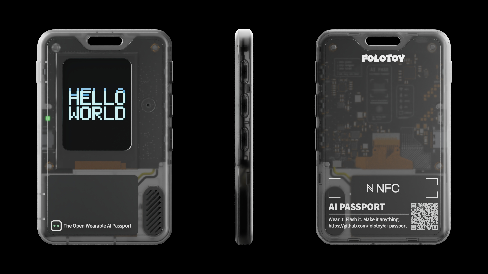

<p align="center">
  
</p>

# AI Passport · 航空警示音

**A cockpit warning-sound companion for aviation enthusiasts, running on FoloToy AI Passport (ESP32-C3 + LVGL).**

「航空警示音」是运行在 FoloToy AI Passport 上的民航驾驶舱警示音应用：瀑布流宫格收录
24 条真实民航机型告警音效，方向键浏览、确认键试听；内置听声辨机挑战、场景连播、
GPWS 闹钟与硬件诊断。面向航空爱好者的听辨练习与桌面展示工具，不是飞行模拟器功能模块。

## 功能

### 警示音图鉴（主页）

- 两列瀑布流宫格（104px 错位 12px，卡片 72/96 两档），焦点描边 + 发光
- 24 条真实民航驾驶舱音效（16 kHz / 16 bit / mono PCM，静音修剪 + 峰值归一化 −3 dBFS，约 3.1 MB 内嵌固件）
  - 近地告警：呼啸拉升 / 近地警告 / 地形拉起 / 下沉率警告 / 地形注意 / 空客 GPWS
  - 气动告警：失速警告 / 通用失速 / 风切变 / 爬升指令
  - 系统告警：波音警报 / 主告诫 / 自动驾驶断开 / 最低高度 / 减速提醒 / 减速连呼 / 指点信标 / 液压狗叫
  - 监视告警：冲突告警 / 空客冲突
  - 客舱与无线电：客舱叮咚 / 求救呼叫
- 播放态：84% 遮罩 + 7 段呼吸音波 + 底栏进度条，暂停冻结
- ↑/↓ 长按 120ms/格连续滚动，播放中移动焦点不打断音频

### 主菜单（OK 长按）

| 入口 | 说明 |
| --- | --- |
| 听声辨机 | 挑战轮 10 题 / 无尽模式；听音选条目，每 5 题一道场景题；干扰项优先同家族（PULL UP / RETARD / STALL / TRAFFIC 系），三选项洗牌；答错回放正确答案 |
| 场景连播 | 6 个预设场景按故事线有序连播：起飞 / 进近 / 风切变复飞 / 下降 / 波音 / 空客 |
| GPWS 闹钟 | 时长 1–120 分钟 × 24 曲可选；到点经深睡定时唤醒播曲 |
| 播放统计 | 各条目播放计数 |
| 设置 | 音量（↑/↓ 单击 ±10，长按连调）、连播开关（自然结束接下一条，打断不接棒） |
| 硬件诊断 | 只读快照：重启原因环形日志（8 条，含断电截断与深睡唤醒源）等 |

### 系统行为

- 开机动画（约 1s：光晕 → 飞机 → 扫描环 → 标题 → 进度条，160ms 交叉淡出；任意键跳过；深睡唤醒不播）
- OK 双击关屏/开屏（300ms 背光渐变，关屏期间播放不受影响）
- 闲置 60s 自动熄屏，任意键渐亮唤醒（播放/暂停/弹窗中不熄屏）
- 低电保护：SOC ≤10% 提醒（每放电会话一次）、≤5% 强制深睡保护电芯；电压佐证过滤 CW2017 唤醒重算的伪低电读数
- 状态栏实时时钟与 CW2017 电量（<20% 变红）
- 自绘矢量图标（draw_event，无位图资源）+ 生成式 4 档中文字体子集（Noto Sans CJK SC）

### 已知时序代价（iot_button 组件行为）

双击的判定在第二击抬起时才产生，第一击的单击会先行分发一次：快速双击 OK
会先触发一次播放切换再关屏；在弹窗编辑态快速连点两次 OK 会被判为双击而
关屏。UP/DOWN 双击一律忽略。

## 硬件

| 模块 | 型号或说明 |
| --- | --- |
| MCU | ESP32-C3，8 MB Flash，无 PSRAM |
| 屏幕 | ST7789P3，240 × 320，SPI |
| 音频 | ES8311 Codec |
| 电量计 | CW2017 |
| 按键 | 三按键共用 ADC 输入 |

硬件引脚与面板参数集中定义在 [`components/bsp/include/bsp_pins.h`](components/bsp/include/bsp_pins.h)。

## 快速开始

项目使用 ESP-IDF 5.5.3：

```bash
. $HOME/esp/esp-idf/export.sh
idf.py build
idf.py -p <串口> flash monitor
```

依赖组件由 `dependencies.lock` 锁定，`idf.py build` 会自动拉取到 `managed_components/`。

## 代码结构

```
main/
  main.c         入口与三键输入分发（复用 key_guard 防误触）
  app_catalog.*  条目配置表（名称/时长/配色/图标/内嵌 PCM 符号）
  app_layout.*   瀑布流纯几何计算（host 可测，tests/test_app_layout.c）
  app_audio.*    PCM 播放工作任务（分块写，暂停/切换/连播）
  app_boot.*     冷启动开机动画（关键帧 + 交叉淡出，任意键跳过）
  app_ui.*       LVGL 界面与动效（状态栏/宫格/遮罩/弹窗/菜单/诊断页）
  modal_ctl.h    设置弹窗输入状态机（纯逻辑，tests/test_modal_ctl.c）
  menu_ctl.h     主菜单输入状态机（tests/test_menu_ctl.c）
  quiz_ctl.h     听声辨机出题/判定状态机（tests/test_quiz_ctl.c）
  alarm_ctl.h    GPWS 闹钟设置页状态机（tests/test_alarm_ctl.c）
  scenes.h       场景连播静态表（tests/test_scenes.c）
  bootlog.*      重启历史环形日志（NVS 持久化，tests/test_bootlog.c）
  lowbatt_ctl.h  低电保护决策状态机（tests/test_lowbatt_ctl.c）
  app_sleep.*    深睡与闹钟定时唤醒
  app_shutdown.* 关屏动画与停机路径
assets/
  audio/*.pcm    24 条音效（16k/16bit/mono，EMBED 进固件）
  fonts/*.c      4 档中文字体子集（tools/gen_font.py 生成）
tools/
  gen_font.py    字体子集生成器（清单见 font_manifest.txt）
  validate.sh    静态检查 + host 测试 + 固件构建门禁
tests/           纯逻辑模块的 host 单元测试（不依赖 ESP-IDF/LVGL）
```

纯逻辑状态机与布局计算不依赖 ESP-IDF/LVGL，可直接在 host 上跑测试：

```bash
./tools/validate.sh --static   # 仓库检查 + host 测试
./tools/validate.sh --firmware # ESP-IDF 构建 + 合并镜像校验
```

## 致谢与许可

- 本项目基于 [FoloToy/ai-passport](https://github.com/FoloToy/ai-passport)（MIT License）开发，BSP 与工程规范沿用上游
- 音效素材经整理修剪后以 PCM 内嵌，仅供科普与爱好者学习
- 代码以 [MIT License](LICENSE) 发布

## 免责声明

本项目是航空爱好者的科普与听辨练习工具，与任何航空器制造商无关，不是飞行模拟器部件，不得用于任何实际飞行或安全相关用途。
